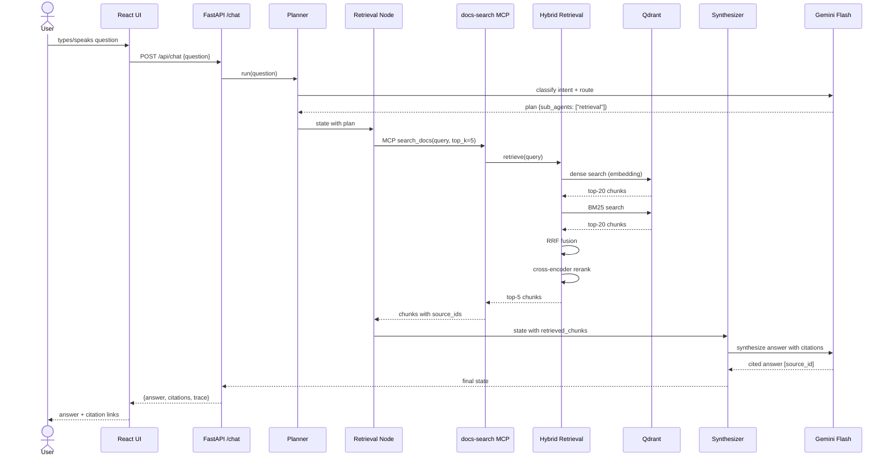
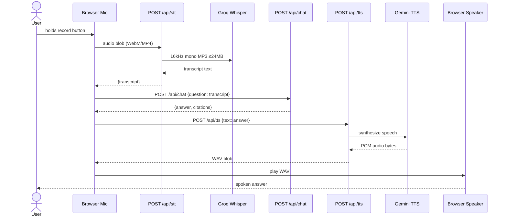
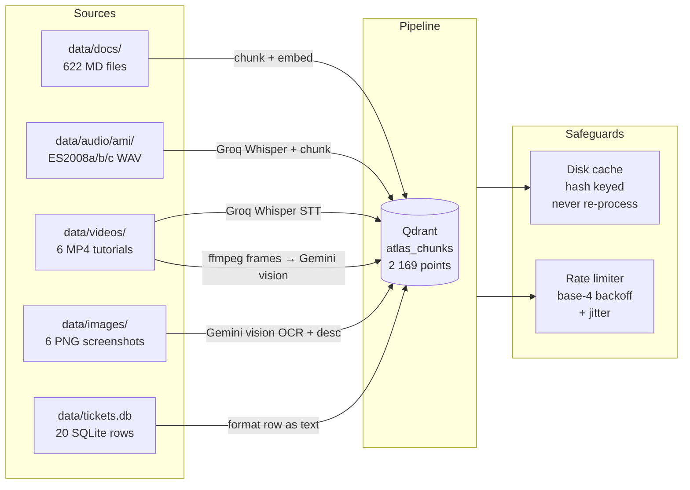
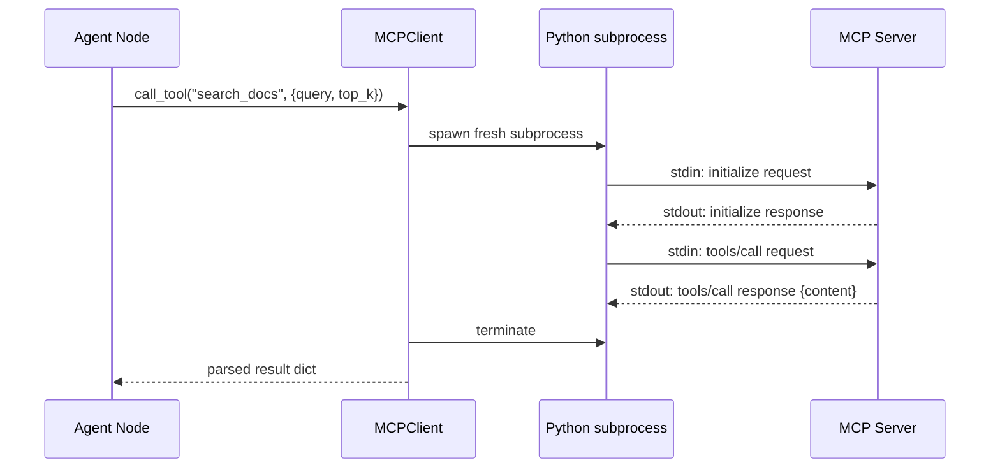

# Atlas — Architecture Diagram

> **Atlas** is a production-grade Multimodal Enterprise Agent Platform that acts as an onboarding
> assistant for a fictional SaaS company's support team. It grounds every answer in a heterogeneous
> knowledge base: GitLab handbook Markdown, Jira/JSM/Confluence tutorial videos, dashboard
> screenshots, and a live SQLite ticketing database.

---

## High-level system topology

```mermaid
graph TD
    subgraph Browser["Browser (React + Vite)"]
        UI[Chat UI<br/>App.jsx]
        VC[VoiceChat<br/>MediaRecorder → mic]
        UI <--> VC
    end

    subgraph FastAPI["Backend — FastAPI :8000"]
        direction TB
        CHAT[POST /api/chat]
        STT_EP[POST /api/stt]
        TTS_EP[POST /api/tts]
        CFG[GET /api/config<br/>GET /health]
    end

    UI  -->|text question| CHAT
    VC  -->|audio blob| STT_EP
    STT_EP -->|transcript| UI
    CHAT -->|cited answer| UI
    UI  -->|answer text| TTS_EP
    TTS_EP -->|WAV audio| VC

    subgraph Agent["LangGraph-style Agent (backend/agent/)"]
        PL[Planner<br/>classify intent → route]
        RN[Retrieval Node<br/>MCP ➜ docs-search]
        VN[Vision Node<br/>MCP ➜ docs-search<br/>image modality]
        AN[Action Node<br/>MCP ➜ ticketing]
        SY[Synthesizer<br/>cited answer]
        PL -->|sub_agents list| RN
        PL -->|sub_agents list| VN
        PL -->|sub_agents list| AN
        RN --> SY
        VN --> SY
        AN --> SY
    end

    CHAT --> Agent

    subgraph MCP["MCP Servers (stdio JSON-RPC 2.0)"]
        DS[docs-search server<br/>search_docs()]
        TK[ticketing server<br/>list_tickets · get_ticket<br/>create · update · assign]
    end

    RN -->|MCP call| DS
    VN -->|MCP call| DS
    AN -->|MCP call| TK

    subgraph Retrieval["Hybrid Retrieval Pipeline"]
        direction LR
        QR[Query Rewriter<br/>HyDE + sub-questions]
        DR[Dense Search<br/>Qdrant cosine]
        BR[BM25 Search<br/>rank_bm25]
        RRF[RRF Fusion]
        RR[Cross-Encoder Reranker<br/>sentence-transformers]
        QR --> DR
        QR --> BR
        DR --> RRF
        BR --> RRF
        RRF --> RR
    end

    DS --> Retrieval

    subgraph VectorDB["Qdrant Cloud (atlas_chunks)"]
        C1[text chunks<br/>n=1 454]
        C2[audio chunks<br/>n=329]
        C3[video chunks<br/>n=360]
        C4[image chunks<br/>n=6]
        C5[ticket chunks<br/>n=20]
    end

    Retrieval --> VectorDB

    subgraph TicketDB["SQLite — tickets.db"]
        T1[tickets table<br/>20 rows]
        T2[ticket_events table]
    end

    TK --> TicketDB

    subgraph LLM["LLM / AI Services"]
        GM[Gemini 2.0 Flash<br/>LLM_PRIMARY_MODEL<br/>planning · synthesis]
        GL[Gemini 2.0 Flash-Lite<br/>LLM_BULK_MODEL<br/>ingestion · frame desc]
        GR[Groq qwen3.8-27b<br/>LLM_FALLBACK_MODEL<br/>fallback · RAGAS judge]
        EM[Gemini Embedding-2<br/>3072-dim embeddings]
        WH[Groq Whisper-large-v3-turbo<br/>STT_MODEL]
        TT[Gemini TTS<br/>TTS_MODEL]
    end

    PL --> GM
    SY --> GM
    DS --> EM
    STT_EP --> WH
    TTS_EP --> TT

    subgraph Ingestion["Ingestion Pipeline (scripts/ingest.py)"]
        ID[Docs ingestor<br/>GitLab handbook MD]
        IA[Audio ingestor<br/>Groq Whisper + diarization]
        IV[Video ingestor<br/>STT + frame sampling<br/>LLM_BULK_MODEL vision]
        II[Image ingestor<br/>OCR + structured desc]
        IT[Ticket ingestor<br/>SQLite → Qdrant]
    end

    ID --> VectorDB
    IA --> VectorDB
    IV --> VectorDB
    II --> VectorDB
    IT --> VectorDB

    subgraph Tracing["Observability"]
        LS[LangSmith<br/>agent + eval traces]
        RL[Rate Limiter<br/>exponential backoff + jitter]
        CA[Disk Cache<br/>hash → JSON<br/>never re-processes]
    end

    Agent --> LS
    Agent --> RL
    Ingestion --> RL
    Ingestion --> CA
```

---

## Data flow: user question → cited answer



---

## Voice loop data flow



---

## Ingestion pipeline (one-time)



---

## MCP server protocol



Each MCP call spawns a fresh subprocess to avoid accumulated connection state
and stay within Gemini free-tier RPM limits.

---

## Component inventory

| Component | Location | Purpose |
|---|---|---|
| FastAPI app | `backend/main.py` | `/chat` `/stt` `/tts` `/health` `/config` |
| Config | `backend/config.py` | Pydantic settings, reads all keys from `.env` |
| Rate limiter | `backend/rate_limiter.py` | Base-4 exp backoff, disk cache |
| Agent graph | `backend/agent/graph.py` | Sequential state machine |
| Planner | `backend/agent/nodes/planner.py` | Intent classification + routing |
| Retrieval node | `backend/agent/nodes/retrieval_node.py` | Calls docs-search MCP |
| Vision node | `backend/agent/nodes/vision_node.py` | Calls docs-search with `modality=image` |
| Action node | `backend/agent/nodes/action_node.py` | Calls ticketing MCP |
| Synthesizer | `backend/agent/nodes/synthesizer.py` | Gemini Flash cited answer |
| MCP client | `backend/agent/mcp_client.py` | JSON-RPC 2.0 subprocess transport |
| Retrieval pipeline | `backend/retrieval/pipeline.py` | HyDE → dense → BM25 → RRF → rerank |
| Dense search | `backend/retrieval/dense.py` | Qdrant cosine, Gemini embeddings |
| BM25 | `backend/retrieval/bm25.py` | rank_bm25, in-memory corpus |
| RRF fusion | `backend/retrieval/fusion.py` | Reciprocal Rank Fusion |
| Reranker | `backend/retrieval/reranker.py` | CrossEncoder (sentence-transformers) |
| Query rewriter | `backend/retrieval/query_rewriter.py` | HyDE + sub-question expansion |
| STT | `backend/voice/stt.py` | Groq Whisper, ffmpeg 16kHz/mono/MP3 |
| TTS | `backend/voice/tts.py` | Gemini TTS → WAV |
| LangSmith tracer | `backend/agent/tracer.py` | REST shim, PATCH span updates |
| docs-search MCP | `mcp_servers/docs_search/server.py` | `search_docs` tool |
| ticketing MCP | `mcp_servers/ticketing/server.py` | 5 ticket tools |
| MCP protocol | `mcp_servers/shared/protocol.py` | JSON-RPC 2.0 base, Python 3.8 native |
| Ingestion | `scripts/ingest.py` | Master runner, all 5 modalities |
| React UI | `frontend/src/App.jsx` | Chat UI, citations, voice button |
| VoiceChat | `frontend/src/components/VoiceChat.jsx` | Hold-to-record, waveform |
| Eval suite | `scripts/eval/` | Retrieval / faithfulness / STT / latency |
